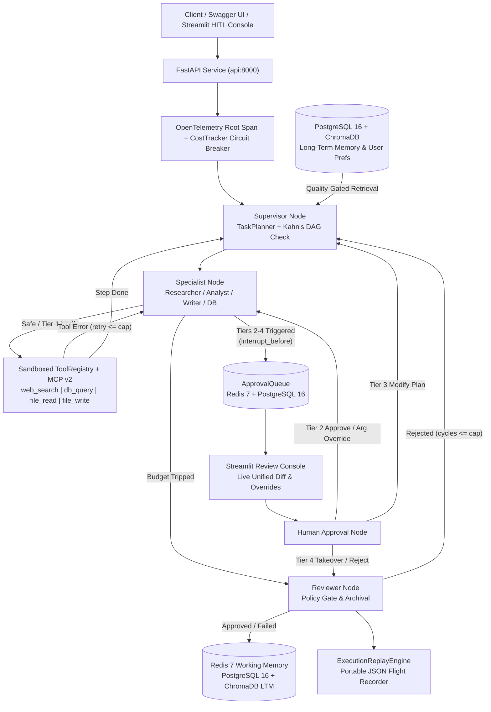

# Enterprise Agent Orchestration Platform

[](https://github.com/kvaruntej24/agent-orchestrator/actions/workflows/ci.yml)

A stateful multi-agent orchestration service built with **Python 3.11**, **LangGraph**, **FastAPI**, **PostgreSQL 16**, **Redis 7**, **ChromaDB**, **Streamlit**, and **OpenTelemetry**.

Instead of relying on unbounded prompt loops, every task runs through an explicit, checkpointed state machine with DAG-validated planning, sandboxed MCP v2 tools, dual-tier memory, 4-tier human-in-the-loop (HITL) approvals, hard token/USD budget circuit breakers, and offline deterministic replay.

---

## Architecture



---

## Core Capabilities

| Layer | Implementation | Verified Behavior |
|---|---|---|
| **Orchestration Graph** | LangGraph `StateGraph`, typed `AgentState`, append-only reducers (`operator.add`), Kahn's algorithm DAG validator | Rejects circular dependencies and invalid specialist roles at parse time; caps tool retries (`max_retries`) and reviewer rewrites (`max_review_cycles`) |
| **Sandboxed Tools & MCP** | Centralized `ToolRegistry` + official MCP v2 server adapter | Path-jail blocks `../.env` traversal (`PermissionError`); `db_query` enforces single-statement read-only `SELECT`; `file_write` requires approval |
| **Dual-Tier Memory** | Redis 7 (String/List/Hash + pipelined TTL), PostgreSQL 16 (SQLAlchemy 2.0), ChromaDB semantic index | Closed-loop retrieval injects only `approved` strategies within `max_prompt_chars`; deterministic importance scoring, consolidation, and 3-store privacy purge |
| **4-Tier HITL Governance** | Priority-ordered `EscalationPolicy`, LangGraph `interrupt_before` checkpointing, Redis + PostgreSQL `ApprovalQueue`, Streamlit review console | Supports Tier 1 `notify` (non-blocking), Tier 2 `approve_action` (with live JSON diff argument override), Tier 3 `modify_plan` (DAG-validated), and Tier 4 `human_takeover` |
| **Observability & FinOps** | Isolated OpenTelemetry `TracerProvider`, `CostTracker` with per-1M model pricing, `ExecutionReplayEngine` | Emits 3-level traces (`orchestrator.run` -> `node.*` -> `tool.*`) under one `trace_id`; hard budget circuit breaker halts overspend with `0` extra subtasks executed; offline JSON replay detects exact matches and counterfactual divergences |
| **Deployment & CI** | Unified FastAPI service, non-root `Dockerfile`, 4-service `docker-compose.yml`, GitHub Actions CI | Runs 15 automated Pytest checks at `$0` API cost; switches between `in_memory`/`live` storage and `mock`/`live` LLM providers via two environment variables |

---

## Quickstart (Zero-Cost Local Mode)

By default, `ORCHESTRATOR_STORAGE_MODE=in_memory` and `ORCHESTRATOR_LIVE_LLM=false`, allowing you to run the API, HITL dashboard, FinOps demo, and test suite locally with zero API spend.

```bash
git clone [https://github.com/kvaruntej24/agent-orchestrator.git](https://github.com/kvaruntej24/agent-orchestrator.git)
cd agent-orchestrator
python -m venv .venv

# Windows PowerShell
.\.venv\Scripts\Activate.ps1
# macOS / Linux
# source .venv/bin/activate

pip install -r requirements.txt
cp .env.example .env
```

### Run the Automated Test Suite (15 Tests Across Phases 1-5)

```bash
pytest
```

### Run the End-to-End Enterprise FinOps Demo

Runs health checks, HITL pause before `file_write`, Tier-2 approval with filename redaction, closed-loop memory recall on Run #2, OpenTelemetry traces, cost tracking, exact + counterfactual replay, and 3-store privacy purge:

```bash
python -m src.orchestrator.demo.enterprise_scenario
```

### Start the FastAPI Service (`http://127.0.0.1:8000/docs`)

```bash
uvicorn src.orchestrator.api.app:app --port 8000
```

### Start the Streamlit HITL Review Console (`http://localhost:8501`)

```bash
streamlit run src/orchestrator/ui/hitl_dashboard.py
```

---

## Docker Compose Stack (Live PostgreSQL 16 + Redis 7)

Run all four services (`api`, `hitl_ui`, `postgres`, `redis`) with persistent volumes and health-gated startup:

```bash